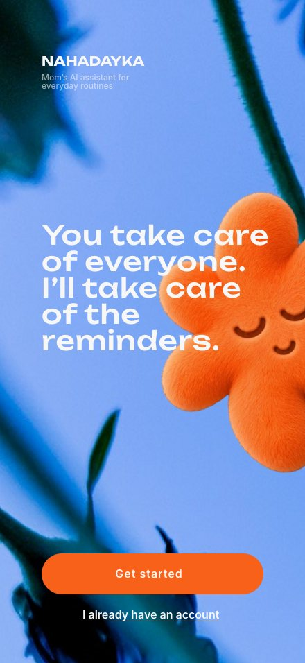
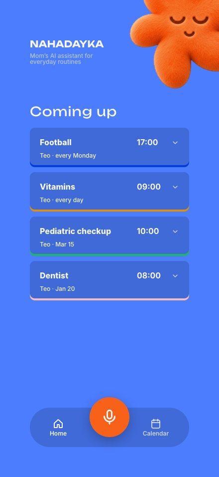
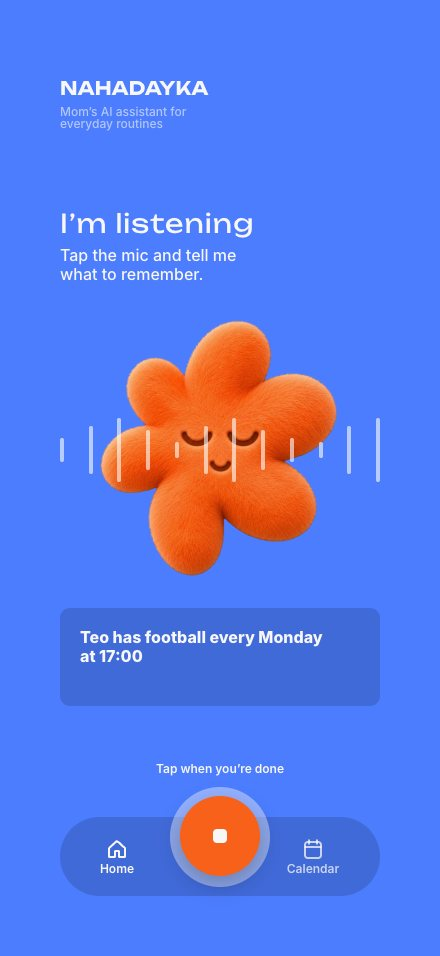
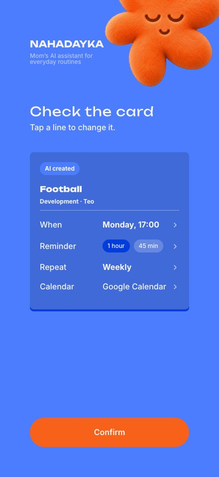
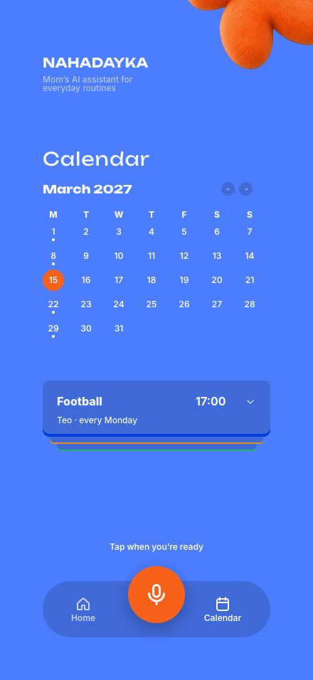

# Hi, I'm Mariya
Product & Visual Designer | AI Design Explorer

I turn chaos into clarity through words and design. My work sits somewhere between UI/UX, visual communication, and AI-powered workflows. I enjoy making complex things easier to understand and bringing structure to messy ideas. My career has never been a straight line — from advertising and marketing to UI/UX, visual design, and now AI. Currently exploring how AI can change the way we think and create without losing the human part of the process.

## Skills

- UI/UX Design
- Visual Communication
- Design Systems
- Creative Direction
- AI-powered Workflows
- Project Management

## Project: Нагадайка (Nahadayka)

An AI assistant for parents: you say what to remember, it turns the sentence into a task card, puts it in the calendar and reminds you in time. This repository holds its design system and a clickable mobile prototype (440 × 956). Voice, calendar and notifications are simulated.

<p>
  
  
  
  
  
</p>

**Look inside**

- [Design system](docs/design-system.md): colours, typography, component tokens and every screen
- [Functional map](docs/functional-map.png): the user journey step by step
- [Product spec](docs/product-spec.md) (in Ukrainian)
- [Prototype source](screens/app.html)

**From Figma to code**

Figma variables → [`design/figma-variables.json`](design/figma-variables.json) → `npm run tokens` → [`tokens.json`](tokens.json) and [`src/styles/tokens.css`](src/styles/tokens.css) → prototype

**Run it locally**

```bash
python3 -m http.server 4173
```

Then open `http://localhost:4173/screens/app.html` (prototype) or `http://localhost:4173/tokens.html` (token preview).
