# Нагадайка design system

> Generated by `python3 scripts/build-design-docs.py` from [`design/figma-variables.json`](../design/figma-variables.json). Do not edit by hand.

One source of truth, in this order: **Figma variables** → [`figma-variables.json`](../design/figma-variables.json) → `npm run tokens` → [`tokens.json`](../tokens.json) and [`tokens.css`](../src/styles/tokens.css) → [the prototype](../screens/app.html).

## Rules

- Solid blue background (`--screen-bg`); the flower photo appears only on the first screen.
- Dark glass surfaces and orange primary actions. Labels on orange are always light.
- Headings use Unbounded, everything else Inter.
- Design values are whole numbers. Screens are mobile only, 440 × 956.
- The mascot has no outline.

## Colour

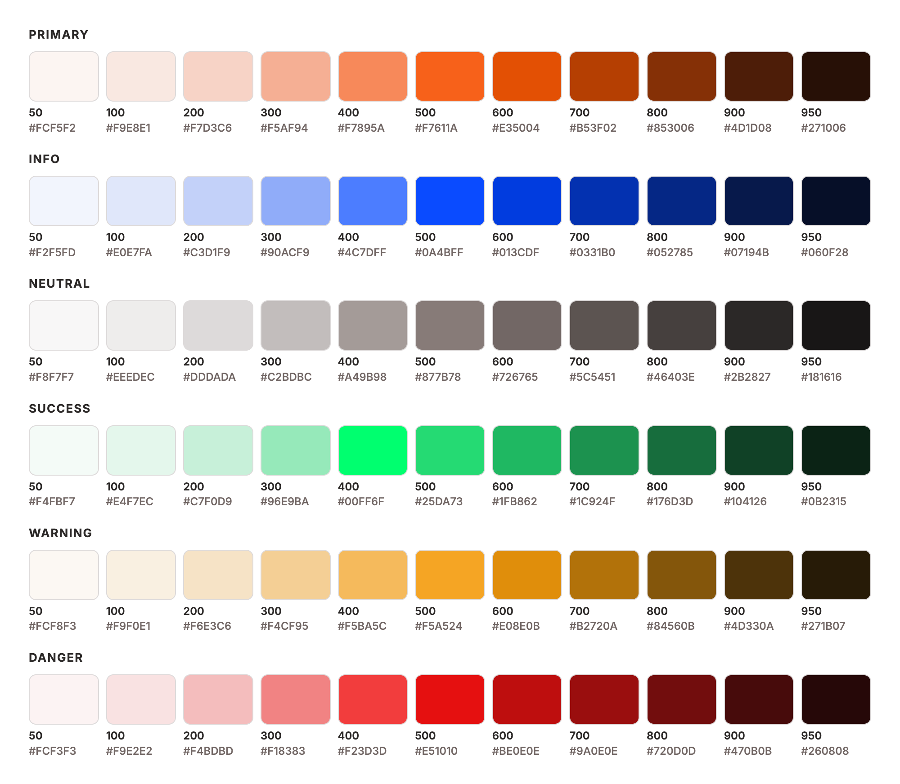

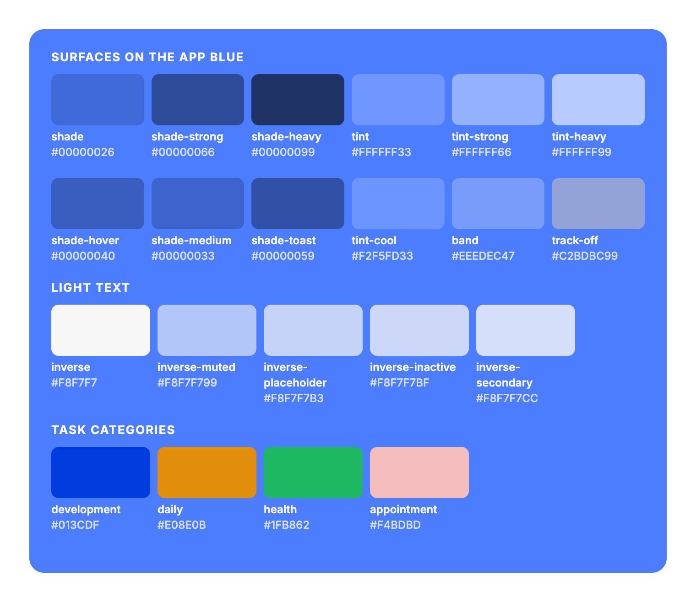

## Typography

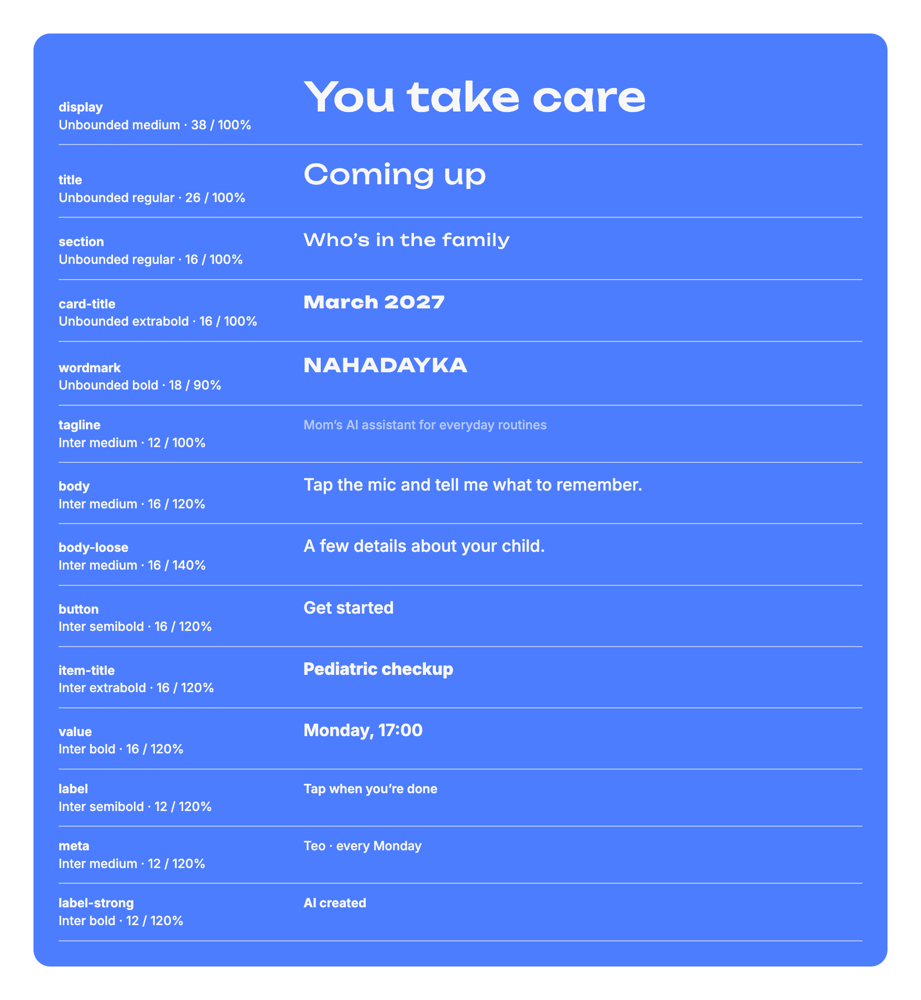

| Text style | Family | Weight | Size | Line height | Letter spacing | Used for |
|---|---|---|---|---|---|---|
| `display` | Unbounded | medium | 38 | 100% | 2% | Welcome headline |
| `title` | Unbounded | regular | 26 | 100% | 2% | Screen titles |
| `section` | Unbounded | regular | 16 | 100% | 2% | Section heading |
| `card-title` | Unbounded | extrabold | 16 | 100% | 2% | Card titles, month, sheet title |
| `wordmark` | Unbounded | bold | 18 | 90% | 2% | Header wordmark |
| `tagline` | Inter | medium | 12 | 100% | 0 | Header tagline (60% opacity) |
| `body` | Inter | medium | 16 | 120% | 0 | Lead and body text |
| `body-loose` | Inter | medium | 16 | 140% | 0 | Multi-line intro |
| `button` | Inter | semibold | 16 | 120% | 0 | Buttons and rows |
| `item-title` | Inter | extrabold | 16 | 120% | 0 | Task and notification titles |
| `value` | Inter | bold | 16 | 120% | 0 | Times and card values |
| `label` | Inter | semibold | 12 | 120% | 0 | Tab bar and hints |
| `meta` | Inter | medium | 12 | 120% | 0 | Subtitles and chips |
| `label-strong` | Inter | bold | 12 | 120% | 0 | Badges and selected chips |

## Shape and spacing

- Radius: `none` 0px, `sm` 6px, `md` 8px, `lg` 12px, `xl` 16px, `card` 10px, `full` 9999px
- Space scale: 2px, 4px, 6px, 8px, 12px, 16px, 20px, 24px, 32px, 40px, 48px, 64px

## Semantic colours added for the concept

| Token | CSS variable | Value |
|---|---|---|
| `border.on-surface-divider` | `--border-on-surface-divider` | `#DDDADA80` |
| `border.on-surface-input` | `--border-on-surface-input` | `#EEEDEC66` |
| `text.inverse-muted` | `--text-inverse-muted` | `#F8F7F799` |
| `text.inverse-placeholder` | `--text-inverse-placeholder` | `#F8F7F7B3` |
| `text.inverse-inactive` | `--text-inverse-inactive` | `#F8F7F7BF` |
| `text.inverse-secondary` | `--text-inverse-secondary` | `#F8F7F7CC` |
| `surface.shade` | `--surface-shade` | `#00000026` |
| `surface.shade-strong` | `--surface-shade-strong` | `#00000066` |
| `surface.shade-heavy` | `--surface-shade-heavy` | `#00000099` |
| `surface.tint` | `--surface-tint` | `#FFFFFF33` |
| `surface.tint-strong` | `--surface-tint-strong` | `#FFFFFF66` |
| `surface.tint-heavy` | `--surface-tint-heavy` | `#FFFFFF99` |
| `surface.shade-hover` | `--surface-shade-hover` | `#00000040` |
| `surface.shade-medium` | `--surface-shade-medium` | `#00000033` |
| `surface.shade-toast` | `--surface-shade-toast` | `#00000059` |
| `surface.tint-cool` | `--surface-tint-cool` | `#F2F5FD33` |
| `surface.band` | `--surface-band` | `#EEEDEC47` |
| `surface.track-off` | `--surface-track-off` | `#C2BDBC99` |

## Component tokens

| Token | CSS variable | Points to | Value |
|---|---|---|---|
| `button.primary.bg.default` | `--button-primary-bg-default` | `semantic.action.primary.default` | `#F7611A` |
| `button.primary.bg.hover` | `--button-primary-bg-hover` | `semantic.action.primary.hover` | `#E35004` |
| `button.primary.bg.active` | `--button-primary-bg-active` | `semantic.action.primary.active` | `#B53F02` |
| `button.primary.bg.disabled` | `--button-primary-bg-disabled` | `semantic.action.primary.disabled` | `#EEEDEC` |
| `button.primary.text` | `--button-primary-text` | `primitives.neutral.50` | `#F8F7F7` |
| `button.primary.text.disabled` | `--button-primary-text-disabled` | `semantic.text.disabled` | `#A49B98` |
| `button.secondary.bg.default` | `--button-secondary-bg-default` | `semantic.action.secondary.default` | `#FFFFFF` |
| `button.secondary.bg.hover` | `--button-secondary-bg-hover` | `semantic.action.secondary.hover` | `#EEEDEC` |
| `button.secondary.bg.active` | `--button-secondary-bg-active` | `semantic.action.secondary.active` | `#DDDADA` |
| `button.secondary.border` | `--button-secondary-border` | `semantic.border.default` | `#C2BDBC` |
| `button.secondary.text` | `--button-secondary-text` | `semantic.text.primary` | `#2B2827` |
| `button.ghost.text` | `--button-ghost-text` | `semantic.text.primary` | `#2B2827` |
| `button.ghost.bg.hover` | `--button-ghost-bg-hover` | `semantic.bg.raised` | `#EEEDEC` |
| `button.danger.bg.default` | `--button-danger-bg-default` | `semantic.action.danger.default` | `#F23D3D` |
| `button.danger.bg.hover` | `--button-danger-bg-hover` | `semantic.action.danger.hover` | `#E51010` |
| `button.danger.bg.active` | `--button-danger-bg-active` | `semantic.action.danger.active` | `#BE0E0E` |
| `button.danger.text` | `--button-danger-text` | `semantic.text.on-danger` | `#0A0B0F` |
| `button.glass.bg` | `--button-glass-bg` | `semantic.surface.shade` | `#00000026` |
| `button.glass.bg-hover` | `--button-glass-bg-hover` | `semantic.surface.shade-hover` | `#00000040` |
| `button.glass.text` | `--button-glass-text` | `semantic.text.inverse` | `#F8F7F7` |
| `button.tint.bg` | `--button-tint-bg` | `semantic.surface.tint-strong` | `#FFFFFF66` |
| `button.tint.text` | `--button-tint-text` | `semantic.text.inverse` | `#F8F7F7` |
| `button.height` | `--button-height` | — | `59px` |
| `button.height-compact` | `--button-height-compact` | — | `39px` |
| `button.width` | `--button-width` | — | `320px` |
| `button.radius` | `--button-radius` | `primitives.radius.full` | `9999px` |
| `input.bg` | `--input-bg` | `semantic.bg.elevated` | `#FFFFFF` |
| `input.border.default` | `--input-border-default` | `semantic.border.default` | `#C2BDBC` |
| `input.border.focus` | `--input-border-focus` | `semantic.border.focus` | `#F7611A` |
| `input.border.error` | `--input-border-error` | `semantic.action.danger.default` | `#F23D3D` |
| `input.text` | `--input-text` | `semantic.text.primary` | `#2B2827` |
| `input.placeholder` | `--input-placeholder` | `semantic.text.muted` | `#877B78` |
| `card.bg` | `--card-bg` | `semantic.bg.elevated` | `#FFFFFF` |
| `card.border` | `--card-border` | `semantic.border.subtle` | `#DDDADA` |
| `screen.width` | `--screen-width` | — | `440px` |
| `screen.height` | `--screen-height` | — | `956px` |
| `screen.margin` | `--screen-margin` | — | `60px` |
| `screen.bg` | `--screen-bg` | `semantic.status.info.bg-strong` | `#4C7DFF` |
| `header.tagline` | `--header-tagline` | `semantic.text.inverse-muted` | `#F8F7F799` |
| `task-card.bg` | `--task-card-bg` | `semantic.surface.shade` | `#00000026` |
| `task-card.radius` | `--task-card-radius` | `primitives.radius.card` | `10px` |
| `task-card.radius-open` | `--task-card-radius-open` | `primitives.radius.md` | `8px` |
| `task-card.height` | `--task-card-height` | — | `79px` |
| `task-card.accent-width` | `--task-card-accent-width` | — | `4px` |
| `task-card.divider` | `--task-card-divider` | `semantic.border.on-surface-divider` | `#DDDADA80` |
| `category.development` | `--category-development` | `semantic.status.info.icon` | `#013CDF` |
| `category.daily` | `--category-daily` | `semantic.status.warning.icon` | `#E08E0B` |
| `category.health` | `--category-health` | `semantic.status.success.icon` | `#1FB862` |
| `category.appointment` | `--category-appointment` | `semantic.status.danger.border` | `#F4BDBD` |
| `chip.bg` | `--chip-bg` | `semantic.surface.tint` | `#FFFFFF33` |
| `chip.bg-selected` | `--chip-bg-selected` | `semantic.status.info.icon` | `#013CDF` |
| `chip.text` | `--chip-text` | `semantic.text.inverse` | `#F8F7F7` |
| `chip.height` | `--chip-height` | — | `26px` |
| `toggle.track-on` | `--toggle-track-on` | `semantic.action.primary.default` | `#F7611A` |
| `toggle.track-off` | `--toggle-track-off` | `semantic.surface.track-off` | `#C2BDBC99` |
| `toggle.knob` | `--toggle-knob` | `primitives.white` | `#FFFFFF` |
| `toggle.knob-shadow` | `--toggle-knob-shadow` | — | `0 1px 2px #0000002E` |
| `field.underline` | `--field-underline` | `semantic.border.on-surface-input` | `#EEEDEC66` |
| `field.placeholder` | `--field-placeholder` | `semantic.text.inverse-placeholder` | `#F8F7F7B3` |
| `tabbar.bg` | `--tabbar-bg` | `semantic.surface.shade` | `#00000026` |
| `tabbar.height` | `--tabbar-height` | — | `79px` |
| `tabbar.text` | `--tabbar-text` | `semantic.text.inverse` | `#F8F7F7` |
| `tabbar.text-inactive` | `--tabbar-text-inactive` | `semantic.text.inverse-inactive` | `#F8F7F7BF` |
| `mic.bg` | `--mic-bg` | `semantic.action.primary.default` | `#F7611A` |
| `mic.size` | `--mic-size` | — | `80px` |
| `mic.halo` | `--mic-halo` | `semantic.surface.tint-strong` | `#FFFFFF66` |
| `mic.halo-size` | `--mic-halo-size` | — | `100px` |
| `mic.shadow` | `--mic-shadow` | — | `0 8px 24px #00000040` |
| `toast.bg` | `--toast-bg` | `semantic.surface.shade-toast` | `#00000059` |
| `sheet.bg` | `--sheet-bg` | `semantic.surface.shade-strong` | `#00000066` |
| `sheet.blur` | `--sheet-blur` | — | `4px` |
| `sheet.close-bg` | `--sheet-close-bg` | `semantic.surface.shade-medium` | `#00000033` |
| `wheel.band` | `--wheel-band` | `semantic.surface.band` | `#EEEDEC47` |
| `notification.bg` | `--notification-bg` | `semantic.surface.shade-heavy` | `#00000099` |
| `notification.action-bg` | `--notification-action-bg` | `semantic.surface.tint-cool` | `#F2F5FD33` |
| `notification.text-secondary` | `--notification-text-secondary` | `semantic.text.inverse-secondary` | `#F8F7F7CC` |
| `calendar.dot` | `--calendar-dot` | `semantic.status.warning.bg-subtle` | `#FCF8F3` |
| `calendar.day-selected` | `--calendar-day-selected` | `semantic.action.primary.default` | `#F7611A` |
| `calendar.day-size` | `--calendar-day-size` | — | `30px` |

## Screens

<table>
<tr><td align="center">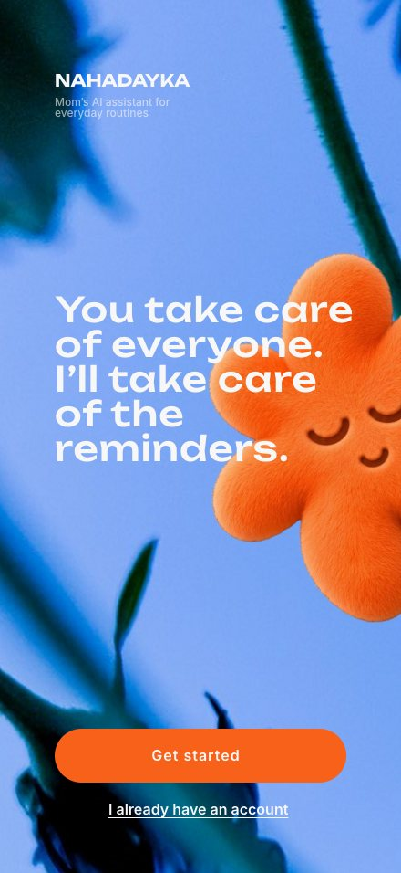 Welcome</td><td align="center">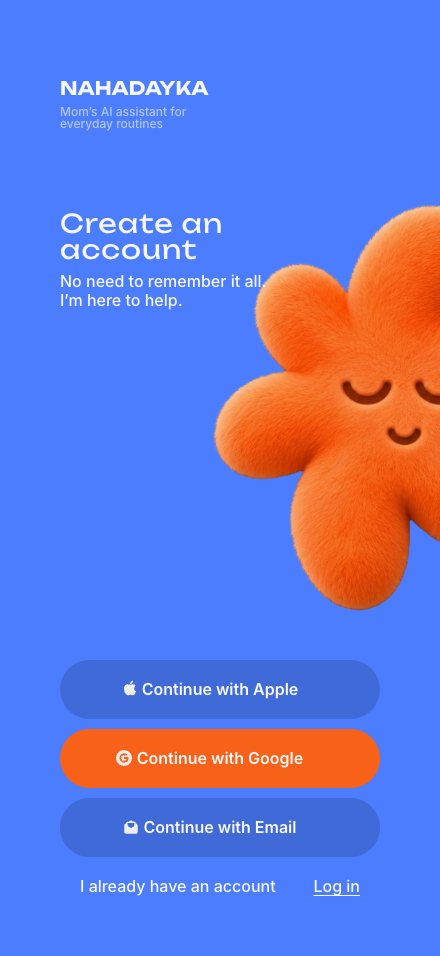 Create an account</td><td align="center">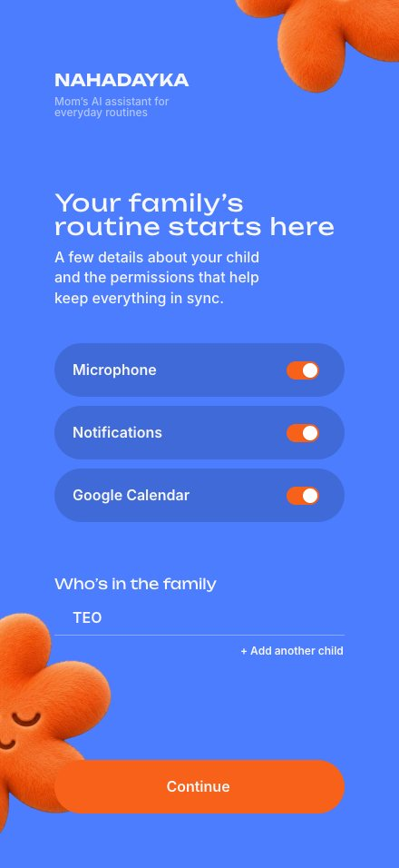 Permissions & child</td><td align="center">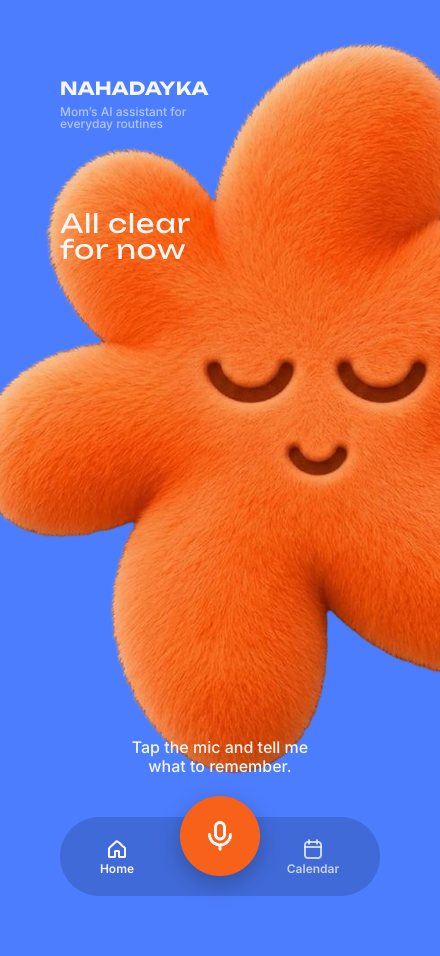 Home, empty</td></tr>
<tr><td align="center">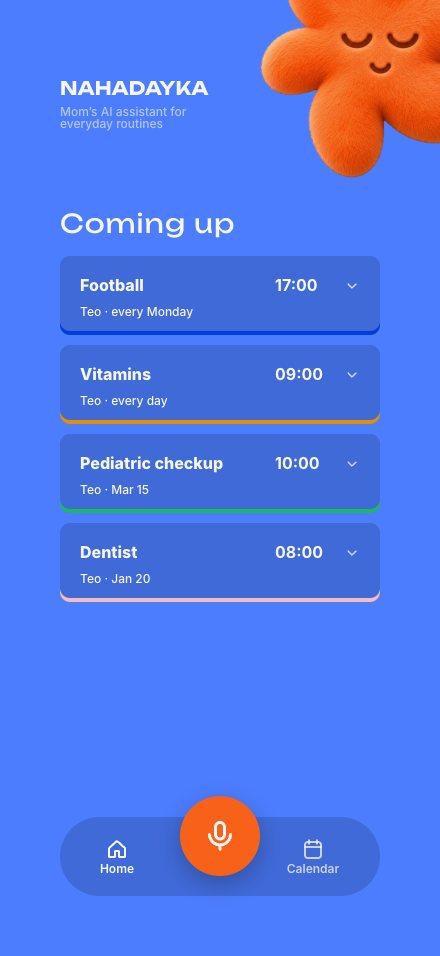 Home, tasks</td><td align="center">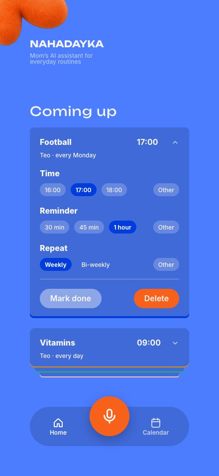 Home, quick edit</td><td align="center">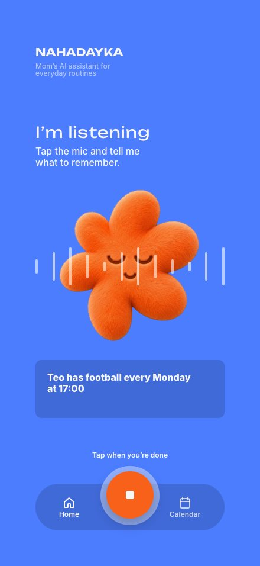 Listening</td><td align="center">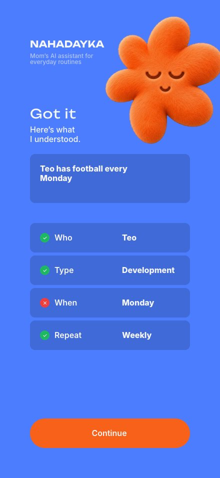 AI understands</td></tr>
<tr><td align="center">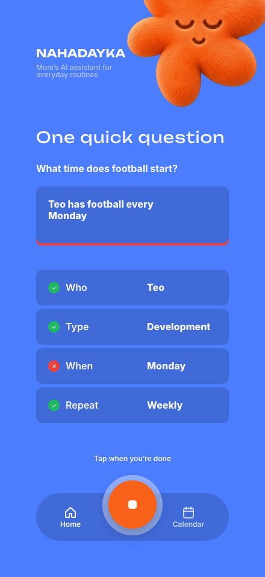 One question</td><td align="center">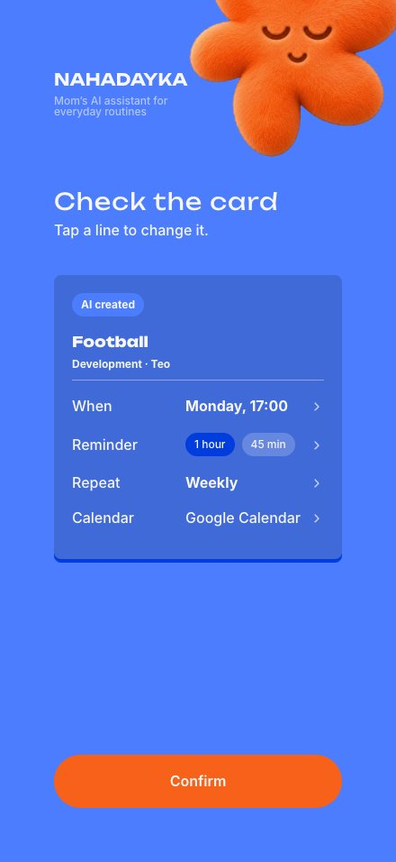 Review</td><td align="center">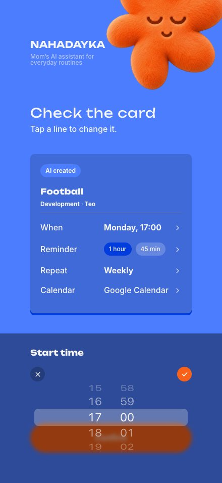 Start time</td><td align="center">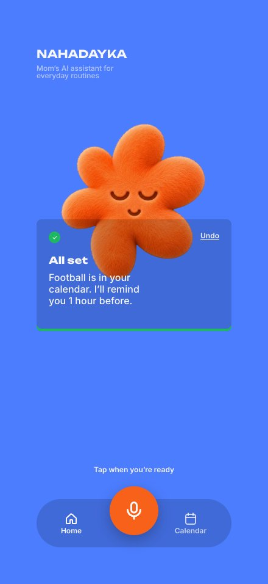 Done</td></tr>
<tr><td align="center">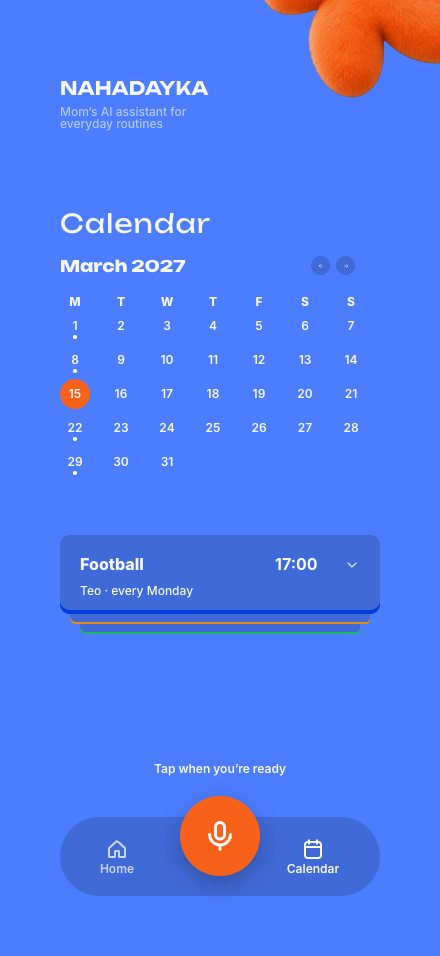 Calendar</td><td align="center">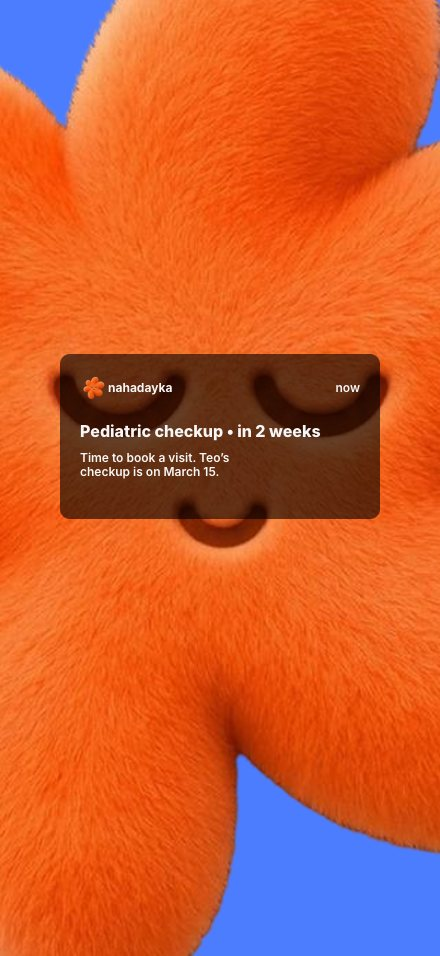 Push</td><td align="center">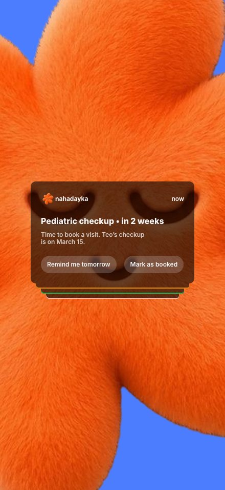 Push, actions</td><td align="center">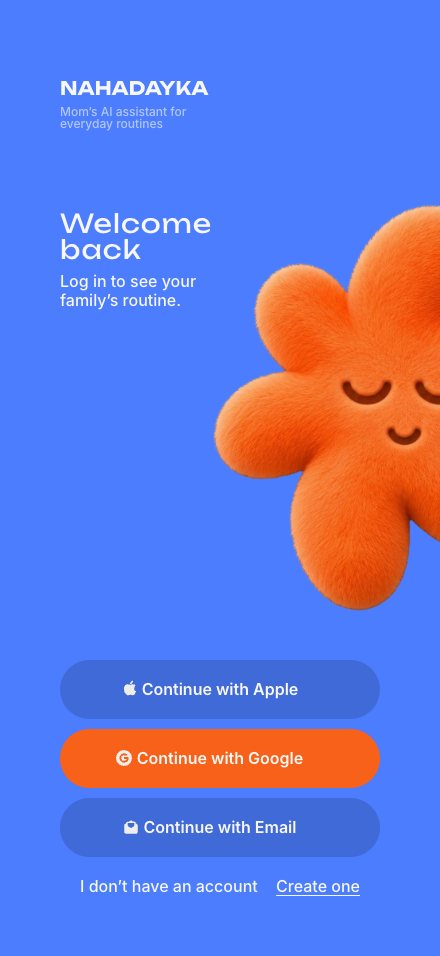 Log in</td></tr>
</table>
